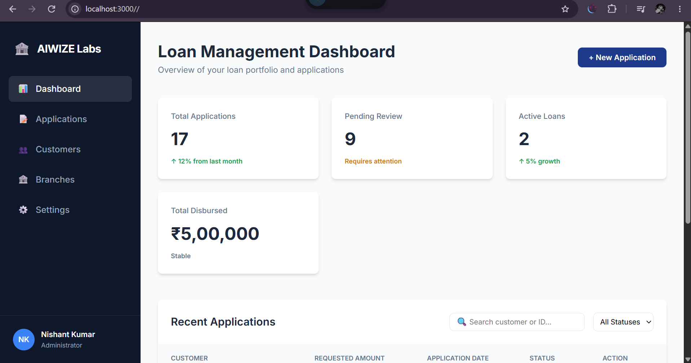

# AIWIZE Labs Loan Management System

A professional loan management platform designed to handle the complete lending lifecycle—from customer onboarding and loan application to disbursement and repayment tracking.

This project serves as a comprehensive demonstration of full-stack development integrating a vanilla JS frontend with a robust PostgreSQL backend.

## 🚀 Key Features

- **Complete Loan Lifecycle**: Manage applications (`Pending` → `Approved` → `Disbursed`), track active loans, and handle `Closed` or `Defaulted` states.
- **Professional Dashboard**: Real-time KPI tracking (Total Applications, Pending Review, Active Loans, Total Disbursed).
- **Multi-Step Application Process**: A validated 4-step form (Personal → Employment → Loan Details → Review) with Indian KYC (PAN) and Credit Score integration.
- **Financial Integrity**: Precise EMI amortization schedules with principal and interest component tracking.
- **Advanced SQL Implementation**: Implements window functions for running balances, CTEs for portfolio analysis, and complex joins for customer-loan mapping.

## 🛠️ Technologies Used

- **Frontend**: HTML5, CSS3 (Inter Font), Vanilla JavaScript.
- **Backend**: Node.js, Express.js.
- **Database**: PostgreSQL.
- **API**: RESTful JSON API.

## 📋 Prerequisites & Installation

### Prerequisites
- Node.js (Latest LTS)
- PostgreSQL (Installed and running)

### Setup Instructions
1. **Clone the repository**
2. **Install dependencies**:
   ```powershell
   npm install
   ```
3. **Database Configuration**:
   Create a `.env` file in the root directory:
   ```env
   DB_HOST=localhost
   DB_PORT=5432
   DB_NAME=loan_management
   DB_USER=your_username
   DB_PASSWORD=your_password
   ```
4. **Database Schema**:
   Run the migrations in order from the `database/migrations/` directory.

## 🏃 Running the Application

```powershell
npm start
```
The application will be available at `http://localhost:3000`.

## 🔌 API Endpoints

| Endpoint | Method | Description |
| :--- | :--- | :--- |
| `/api/health` | GET | Verifies server and database connectivity. |
| `/api/dashboard` | GET | Returns aggregate KPIs for the dashboard. |
| `/api/applications` | GET | Retrieves all loan applications with customer and branch details. |
| `/api/applications/:id` | GET | Fetches full details for a specific application. |
| `/api/customers` | GET | Lists all customers and their total application counts. |
| `/api/branches` | GET | Returns list of available bank branches. |
| `/api/applications` | POST | Submits a new loan application (creates customer & employment records). |

## 📊 SQL Practice Capabilities

The database is seeded to support the following advanced SQL exercises:
- **Window Functions**: Computing running principal balances and outstanding debt.
- **Deduplication**: Identifying duplicate applicants using PAN and phone numbers.
- **Aggregation**: Calculating NPA (Non-Performing Asset) rates and portfolio quality.
- **Complex Joins**: Mapping customers to multiple applications and their corresponding branches.

## 📂 Project Structure
- `server.js`: Express backend and API logic.
- `db.js`: PostgreSQL connection pool management.
- `index.html`: Main dashboard and application UI.
- `js/app.js`: Frontend logic, API integration, and form validation.
- `css/style.css`: Professional dashboard styling.
- `database/migrations/`: Versioned SQL schema and seed scripts.

## 🖼️ Application Screenshots

### Loan Application Form

